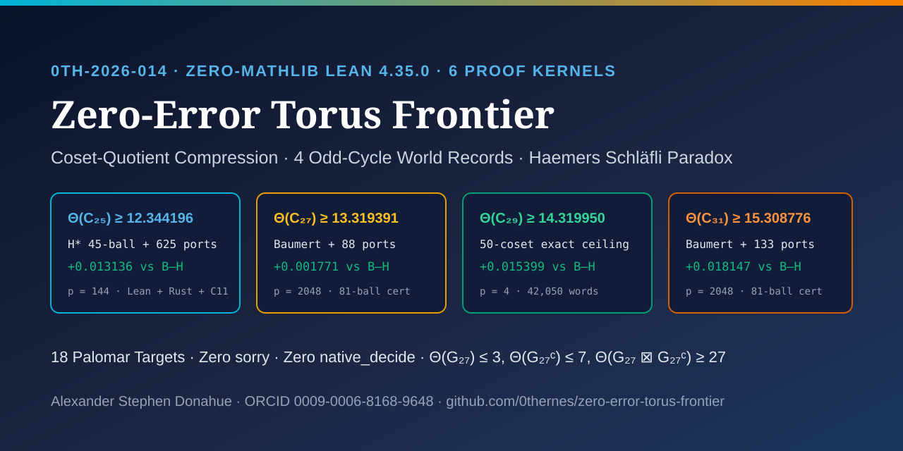

# Zero-Error Torus Frontier (`0TH-2026-016`)

[](https://github.com/0thernes/zero-error-torus-frontier/actions/workflows/ci.yml)
[](https://0thernes.github.io/zero-error-torus-frontier/)
[](lean/lean-toolchain)
[-059669.svg)](lean/formalization.yaml)
[](LICENSE)

Zero-Mathlib Lean 4.35.0 formalization and multi-language verification suite for coset-quotient constructions in $C_n^{\boxtimes 4}$, four kernel-checked lower bounds on the Shannon capacity of $C_{25}, C_{27}, C_{29}, C_{31}$, a weighted clique-cover upper bound, and integer forms of known upper bounds (Haemers 1979, Lovász 1979), checked by six proof kernels. The bounds for $C_{25}$ and $C_{29}$ exceed the largest published values we found; the bounds for $C_{27}$ and $C_{31}$ are below values published in 2003 (see below and [`ERRATA.md`](ERRATA.md)).



- **Interactive Explorer & Proof Blueprint DAG:** <https://0thernes.github.io/zero-error-torus-frontier/> ([Blueprint](https://0thernes.github.io/zero-error-torus-frontier/blueprint.html))
- **Frozen AMS-LaTeX Monograph:** [`dist/Donahue_2026_zero_error_torus_frontier.pdf`](dist/Donahue_2026_zero_error_torus_frontier.pdf)
- **Author:** Alexander Stephen Donahue · Independent Researcher, Spokane, WA, USA · ORCID [`0009-0006-8168-9648`](https://orcid.org/0009-0006-8168-9648)
- **Maintenance status:** Active (`v1.0.0` — frozen proof & manuscript archive; errata and extensions tracked via GitHub Issues).

---

## Headline Machine-Verified Results

Every theorem below is proved in standalone zero-Mathlib Lean 4.35.0 (`lean/`), with **zero `sorry`**, **zero `admit`**, **zero `native_decide`** and **zero custom axioms** in the proved modules (axioms `⊆ {propext, Classical.choice, Quot.sound}` for all 32 audited declarations). The only `sorry` occurrences are the 18 intentional ones in the statement-only comparator stub `lean/PalomarChallenge.lean`, which is excluded from the default build. The 18 contract targets are replayed by **six proof kernels** (`lean`, `leanchecker-paranoid`, `lean4lean`, `nanoda`, `con-leche`, `con-ron` via `lake comparator --paranoid`) in CI.

Shannon capacity $\Theta$ is not defined in Lean. Each capacity bound below is a consequence, outside Lean, of an integer statement about independent sets in a strong power, via $\Theta(G) = \sup_d \alpha(G^{\boxtimes d})^{1/d}$.

### Four Kernel-Checked Lower Bounds for $C_{25}, C_{27}, C_{29}, C_{31}$

The comparison column is the largest published value we found: the $d=4$ entries of Codenotti, Gerace and Resta, *Some remarks on the Shannon capacity of odd cycles*, Ars Combinatoria 66 (2003) 243–257, Table 1. The repository first compared against older third-power values; that comparison was wrong (see [`ERRATA.md`](ERRATA.md)). The prior-work search (dated 2026-11-26) was not exhaustive.

| Odd Cycle | Best published value found (CGR 2003, Table 1, $d=4$) | Our $\alpha(C_n^{\boxtimes 4})$ base | Certified 15-Decimal Lower Bound | Difference | Lovász $\vartheta(C_n)$ | Lean Theorem |
|---|---:|---:|---:|---:|---:|---|
| **$C_{25}$** | $23125^{1/4} = 12.331628572798$ | 23125 (equals the published value) | **`12.344196091426841`** | `+0.012567519` | `12.450522` | `t2a_c25_world_record` ($p=144$, $H^*$ 625 ports) |
| **$C_{27}$** | $31522^{1/4} = 13.324577316143$ | 31466 | **`13.319390984674515`** | `-0.005186` (below) | `13.454204` | `t2b_c27_world_record` ($p=2048$, 88 ports) |
| **$C_{29}$** | $42017^{1/4} = 14.317139619218$ | 42050 | **`14.319949949077991`** | `+0.002810330` | `14.457375` | `t2c_c29_world_record` ($p=4$, 50 cosets) |
| **$C_{31}$** | $54934^{1/4} = 15.309475277725$ | 54913 | **`15.308776193986504`** | `-0.000699` (below) | `15.460135` | `t2d_c31_world_record` ($p=2048$, 133 ports) |

The bounds for $C_{25}$ and $C_{29}$ exceed the largest published values we found. The bounds for $C_{27}$ and $C_{31}$ are proved correctly but are weaker than the 2003 values; they are not best known. The Lean theorem names `t2b_c27_world_record` and `t2d_c31_world_record` are historical; they are kept in `v1.0.0` because renaming would change the comparator contract. For $C_{29}$ the gain over the 2003 value is 33 words in $C_{29}^{\boxtimes 4}$ (42050 versus 42017). For $C_{25}$ the base set has the published size 23125; the gain comes from a port system and the substitution tables of Buys, Polak and Zuiddam, whose framework this work follows. Lean proves each printed 15-decimal value as a lower bound; that it is the largest such value (last-digit tightness) is a computation outside Lean.

### All Four Pillars (`T1a`–`T4d`, 18 Palomar Targets)

1. **Pillar I — Coset-Quotient Lifting and Two Families (`CosetQuotient.lean`):**
   - `T1a`–`T1b`: For $n \ge 9$ (resp. $n \ge 15$), an independent set of size $M$ in the quotient graph for $H_{\mathrm{BPZ}} = \langle(1,0,0,2),(0,1,2,0)\rangle$ (resp. $H^* = \langle(1,0,0,2),(0,1,0,4)\rangle$) lifts to $M n^2$ points of $C_n^{\boxtimes 4}$; double-counting upper bounds $\lfloor n\lfloor n/4\rfloor/4\rfloor$ and $\lfloor n\lfloor n/8\rfloor/2\rfloor$ on these quotient graphs. These bound unions of cosets of one fixed subgroup, not $\alpha(C_n^{\boxtimes 4})$. We did not find $H^*$ in the literature we read; this was not a systematic search.
   - `T1c`: For $n \ge 9$, every $H_{\mathrm{BPZ}}$ shift with $e_3 - 2e_0 = \pm 1$ conflicts with another point of its own coset; for $n \ge 15$ the $H^*$ shift $(0,0,\pm 1,0)$ is private; quotient ball sizes $45$ versus $49$ evaluated at $n = 19, 21, 23, 25$.
   - `T1d`–`T1e`: Two families of coset-union codes that meet the quotient ceiling: $n = 4m+1$ with $m \ge 5$ and $m \equiv 0, 1 \pmod 4$ ($H_{\mathrm{BPZ}}$), and $n = 8k+1$ with $k \ge 3$ ($H^*$). Many of these sizes are published. All `T1e` sizes equal published bounds: Codenotti–Gerace–Resta 2003, Theorem 1, for odd $k$, and the Baumert et al. (1971) value $(n^4-n^3)/16$ for even $k$. For `T1d`, the case $m \equiv 0 \pmod 4$ gives the same Baumert et al. value, and $n = 21$ (11466 words) is in the Buys–Polak–Zuiddam Lean repository. The sizes for $m \equiv 1 \pmod 4$, $m \ge 9$ exceed the 2003 table entries at $n = 37$ and $n = 53$; later literature for these $n$ was not searched. The $n^2$-port `RichPortSystem` for odd $k$ is the separate kernel-checked definition `WorldRecords.hstarOddRichPortSystem`, outside the 18-target contract.
   - `T1f`: The Baumert et al. (1971) expansion map $C_{p+2}^{\boxtimes d} \to C_p^{\boxtimes d}$ ($p \ge 5$) sends conflicting vertices to conflicting vertices and pulls independent sets back to independent sets. The cardinality formula is proved separately, for $d=4$ and $H_{\mathrm{BPZ}}$ lists with $p \ge 9$ (`baumertExpandList_len`, `baumertExpandList_nodup_and_indep`), outside the contract.
2. **Pillar II — Four Certified Lower Bounds (`WorldRecords.lean`):**
   - `T2a`–`T2d`: Chunked 81-ball certificates and 28-digit monotonic fixed-point truncation certify the four printed 15-decimal values as lower bounds without `native_decide`.
3. **Pillar III — Separation Calculus (`SeparationCalculus.lean`):**
   - `T3a`: For the repository's own 7-vertex graph $G_7$: an induced 5-cycle (`B-A-V-H-D`), $\alpha(G_7) \ge 3$, and $\alpha(G_7^{\boxtimes d}) \le 3^d$ by a 3-clique cover (so $\Theta(G_7) = 3$, outside Lean). The upper bound comes from the clique cover, not from the 5-cycle.
   - `T3b`: Weighted fractional-clique-cover upper bound for any graph; for the $C_{25}$ 625-port profile it gives $46875/2$ per arity. Optimality of this value is not proved.
   - `T3c`: A two-alphabet, two-graph form of the BPZ combining rule (Tandon, arXiv:2608.30273, Proposition 1; Buys–Polak–Zuiddam Lean repository, `Realisation.multiSubst`), plus kernel-checked admissibility of the five BPZ tables `T2a`, `T3c`, `T3e`, `C4a`, `C4b`. This does not resolve any published open problem: the two-sided extension of Tandon's Theorem 1 mentioned in his concluding section is not addressed.
4. **Pillar IV — Integer Forms of Known Upper Bounds (`HaemersParadox.lean`):**
   - `T4a`–`T4b`: Haemers's (1979) matrix-rank bound over any `SimpleField`, and an integer orthogonal-representation bound for vectors of equal squared norm $D$ (no floating point or real analysis).
   - `T4c`: Lovász's (1979) pentagon bound in integer form: $\alpha(C_5^{\boxtimes 2}) \ge 5$ and $\alpha(C_5^{\boxtimes d})^2 \le 5^d$, via the $\mathbb{Z}[\sqrt{5}]$ Gram idempotent $M_5^2 = 5(\sqrt{5}-1)M_5$. $\Theta(C_5) = \sqrt{5}$ follows outside Lean.
   - `T4d`: A zero-Mathlib, six-kernel-checked proof of Haemers's 1979 Schläfli-graph example: $\alpha(G_{27}^{\boxtimes d}) \le 3^d$ ($\mathbb{Z}^8$ handle), $\alpha(\overline{G_{27}}^{\boxtimes d}) \le 7^d$ ($27 \times 7$ $\mathbb{F}_2$ factorization), and $\alpha(G_{27} \boxtimes \overline{G_{27}}) \ge 27 > 21$. We did not search for earlier formalizations and make no priority claim.

---

## Quickstart (Verified from Clean Clone)

### 1. Zero-Mathlib Lean 4.35.0 Formal Verification (about a minute; 70 s in the 2026-11-26 audit rebuild)
```bash
cd lean
lake build
lake env lean VerifyAxioms.lean
lake env leanchecker --fresh Solution
lake env leanchecker-paranoid --fresh Solution
# On Linux with bubblewrap (runs all 6 independent proof kernels):
lake check --paranoid
lake comparator --config comparator.json --paranoid
```

### 2. Independent Multi-Language Differential Verifiers
```bash
# Stdlib-only Rust verifier (zero external crates)
cd rust && cargo test --release && cargo run --release -- --verify-all

# Strict ISO C11 verifier (-std=c11 -Wall -Wextra -Wpedantic -Werror + ASan/UBSan + fuzz)
cd native && make test && make sanitize && make fuzz

# Exact 80-digit Python oracle, pytest, Hypothesis property tests & anti-drift audit
python examples/quickstart_demo.py
pytest -v tests/test_all.py
python scripts/check_readme_axioms.py
python scripts/check_citations.py
```

## Usage Examples

### Verify all four pillars and print exact 15-decimal floors (Python)
```python
from pathlib import Path
from torus_frontier import verify_all_pillars, hstar_family, baumert_factored_card, Q25_HBPZ

report = verify_all_pillars(Path("data/witnesses.json"))
assert report["all_ok"] is True
assert report["ball_hstar_25"] == 45 and report["ball_hbpz_25"] == 49
assert baumert_factored_card(25, Q25_HBPZ) == 31466
n, qstar_25 = hstar_family(3)  # C_25 exact 37-coset H* staircase
```

### Run the standalone zero-dependency Rust or ISO C11 CLI verifiers
```bash
./rust/target/release/zero-error-torus-frontier --verify-all
./native/build/torus_cli --verify-all
just reproduce
```

---

## Epistemic Boundaries & Explicitly Open Problems

See [`CLAIMS.md`](CLAIMS.md) and [`LIMITATIONS.md`](LIMITATIONS.md) for the complete epistemic ledger. In particular:
- Determining the **exact** Shannon capacity $\Theta(C_n)$ for any odd $n \ge 7$ (including $C_7, C_{25}, C_{27}, C_{29}, C_{31}$; Mega-Atlas `CS-049`) remains **explicitly open** and is **not** claimed solved here. All capacity results here are lower bounds, except the integer forms of known upper bounds in Pillar IV.
- No published open question is resolved. Earlier versions of this README claimed that `T3c` resolves an "Open Problem #2" of Tandon (arXiv:2608.30273); that preprint has no numbered open problem, and `T3c` is a form of its own Proposition 1. Earlier versions also called all four bounds "world records"; two of them are below 2003 published values. Corrections are logged in [`ERRATA.md`](ERRATA.md). The audit record is [the 2026-11-26 statement audit](https://github.com/0thernes/0thernes-research-archive/blob/main/docs/reviews/2026-11-26-statement-audit.md).
- The separation calculus, the five substitution tables and the coset code for $C_{21}$ come from the Lean repository of Buys, Polak and Zuiddam (<https://github.com/spectra-research/shannon-capacity-lean>, files `ShannonBounds/CosetC21.lean`, `CosetC23.lean`, `Layered.lean`). The $C_{25}$/$C_{29}$ coset codes and the $C_{27}$/$C_{31}$ expansion-plus-ports steps follow their $C_{21} \to C_{23}$ construction.
- Claim `C-EX1` (exhaustive $n^4$ 2D subgroup scan for $n \in \{19,21,23,25\}$ showing minimum ball size $45$) is tagged `[EXACT-COMP]`, distinct from the universally proved `[LEAN-6K]` theorems.

---

## Repository Layout & Documentation

- `lean/` — Zero-Mathlib Lean 4.35.0 library (`GraphCore`, `CosetQuotient`, `SeparationCalculus`, `WorldRecords`, `HaemersParadox`, `NonVacuity`, `AdversarialTests`, `Challenge`, `Solution`, `PalomarChallenge`, `PalomarSolution`, `VerifyAxioms`).
- `rust/`, `native/`, `python/`, `reference/` — Independent Rust, ISO C11, and 80-digit Python differential verification engines.
- `paper/` & `dist/` — AMS-LaTeX source, 5 vector PDF figures, frozen PDF monograph, and clean-room verified `arxiv_submission.tar.gz`.
- `docs/` — [Architecture](docs/architecture.md), [Statement Fidelity](docs/statement-fidelity.md), [Threat Model](docs/threat-model.md), [Operations](docs/operations.md), [FAQ](docs/faq.md), [Glossary](docs/glossary.md), [10-Pass Review](docs/10-pass-review.md), [Red-Team Review](docs/reviews/adversarial-red-team-review.md), [ADRs](docs/adr/), and [GitHub Pages site](docs/site/).
- `HARDENING_LOG.md`, `MANIFEST.sha256`, `REPLICATION.md`, `CITATION.cff`, `llms.txt`.

## License

Dual-licensed: all source code is licensed under [Apache-2.0](LICENSE); all prose, paper text, documentation, and figures are licensed under [CC-BY-4.0](LICENSE-DOCS) (machine-declared in [`REUSE.toml`](REUSE.toml)).
